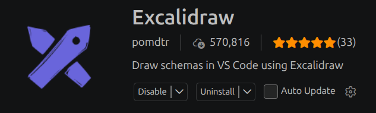

# Diagramas para ISW II

Este repositorio reúne los diagramas de secuencia y de diseño web del proyecto. Los diagramas se editan en Excalidraw y se organizan por caso de uso (CU).

```text
.
├── Diagrama de secuencia/                 # Diagramas de interacción por caso de uso
│   ├── CU #1.excalidraw
│   ├── CU #4 - crear evento.excalidraw
│   ├── CU #4 - eliminar evento.excalidraw
│   ├── CU #4 - listar eventos.excalidraw
│   ├── CU #4 - modificar evento.excalidraw
│   └── templates/                         # Plantillas reutilizables de secuencia
│       ├── Template.excalidraw
│       └── estereotipos/                  # Iconos SVG y elementos JSON para Excalidraw
│           ├── Actor.svg
│           ├── Client Page.svg
│           ├── Form Page.svg
│           ├── Server Page.svg
│           ├── actor.json
│           ├── client_page.json
│           ├── controller.json
│           ├── form_page.json
│           └── server_page.json
├── Diagramas de diseño web/               # Diagramas de páginas y navegación
│   ├── CU #1.excalidraw
│   ├── CU #4.excalidraw
│   └── templates/                         # Recursos reutilizables de diseño web
│       └── estereotipos/
│           ├── Client Page.svg
│           ├── Form Page.svg
│           ├── Server Page.svg
│           ├── client_page.json
│           ├── form_page.json
│           └── server_page.json
├── estereotipos og/                       # Iconos originales de referencia
│   ├── Actor.png
│   ├── Client Page.png
│   ├── Form Page.png
│   └── Server Page.png
├── Instrucciones Diagrama de diseño web.txt
└── README.md
```

Los archivos `.excalidraw` contienen los diagramas editables. Para crear uno nuevo, guarda una copia de la plantilla o de un diagrama existente en el directorio correspondiente, con el número del caso de uso en el nombre. Si un caso de uso tiene varios diagramas, añade la operación, por ejemplo: `CU #4 - crear evento.excalidraw`.

Cada directorio `templates/estereotipos/` contiene los recursos propios de ese tipo de diagrama: los `.svg` son los iconos simplificados con estética de Excalidraw y los `.json` contienen elementos reutilizables en el formato del portapapeles de Excalidraw. El directorio `estereotipos og/` conserva los PNG originales como referencia visual.

## Forma de trabajo

Vamos a utilizar Excalidraw para esto, pero la versión web, la idea es utilizar la versión de VS Code que funciona de manera offline, para esto solo hay que instalar la extención


https://marketplace.visualstudio.com/items?itemName=pomdtr.excalidraw-editor

Una vez instalada debería funcionar con solo abrir el archivo (hay que poner el espacio de trabajo como confiable en VS Code para que active las extensiones)

## Workflow

En este repositorio existen tres ramas:

- `main`
- `secuencia`
- `diseño`

La persona responsable por hacer los diagramas de secuencia deberá subir los cambios a la rama `secuencia`, y la persona encargada de los diagramas de diseño, a la rama `diseño`.

Cuando ya tengan varios diagramas hechos, van a hacer una PR para que el administrador del repositorio revise el trabajo, y en caso de aceptarse, se enviarán los cambios a la rama `main`, en caso de rechazo se explicará el motivo.

Se dará por terminado cuando en `main` estén todos los diagramas.

## Deadline

**Lunes 26/10/2026**
